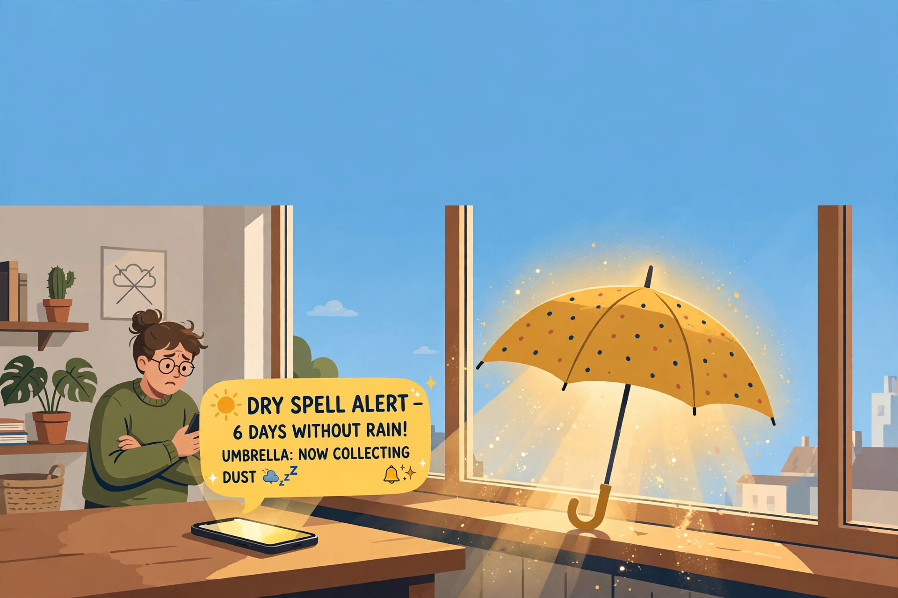
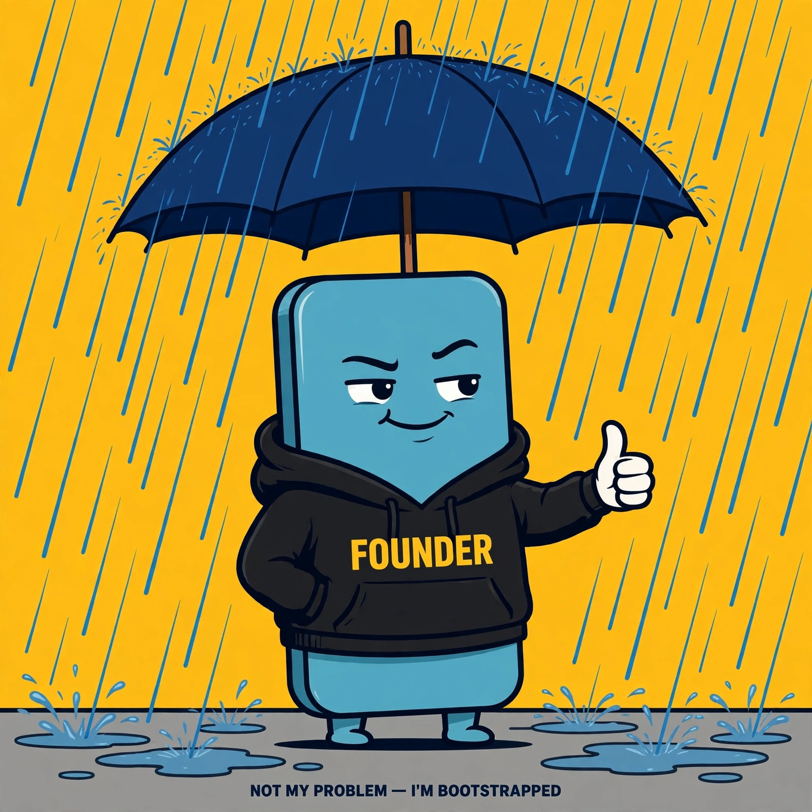
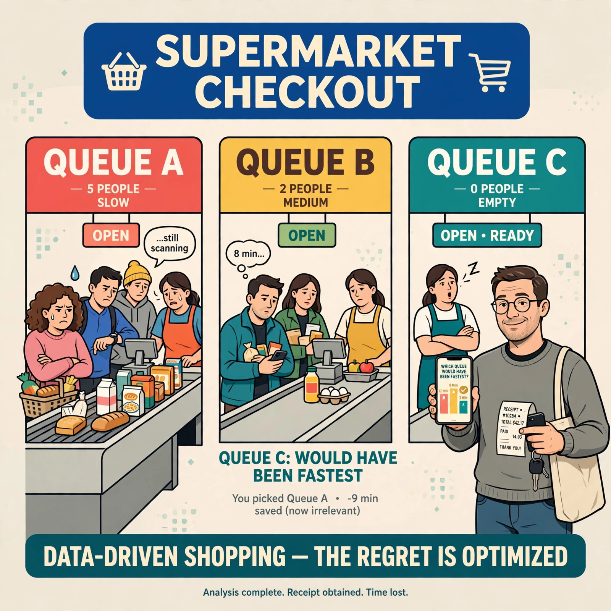
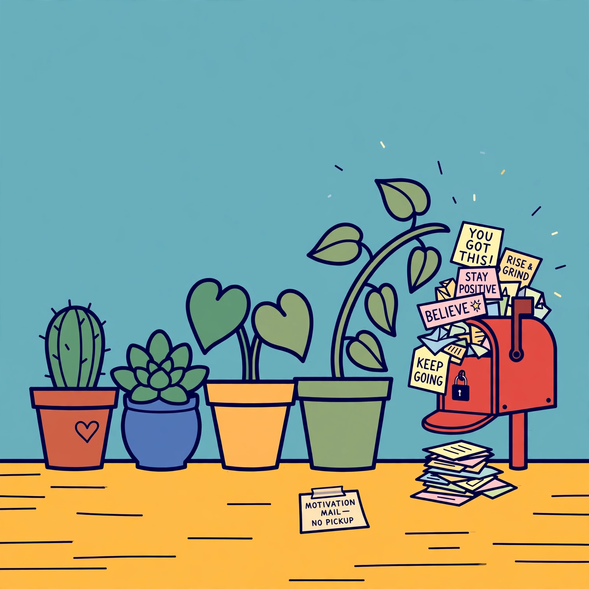

# makefun-worstapp-20261125

[](https://make.fun/bounty/u-plucky-sparrow-67-the-worst-app-idea-ever-pitched-a0396b23?utm_source=github&utm_medium=readme&utm_campaign=u-plucky-sparrow-67-the-worst-app-idea-ever-pitched-a0396b23)
[](https://make.fun/bounty/u-plucky-sparrow-67-the-worst-app-idea-ever-pitched-a0396b23/leaderboard?utm_source=github&utm_medium=readme&utm_campaign=u-plucky-sparrow-67-the-worst-app-idea-ever-pitched-a0396b23)
[](https://make.fun/bounty/u-plucky-sparrow-67-the-worst-app-idea-ever-pitched-a0396b23?utm_source=github&utm_medium=readme&utm_campaign=u-plucky-sparrow-67-the-worst-app-idea-ever-pitched-a0396b23)

**UmbrellaDry** — a pitch for the worst, most useless app imaginable, in exactly one sentence. This repo is an entry to make.fun's *The Worst App Idea Ever Pitched* bounty: the program writes the pitch to `entry.txt`, and a deadpan AI product critic judges it head-to-head against the field on how specific, how funny and how perfectly pointless it is.



*The product, exactly as pitched: your umbrella, confirmed dry, four to six hours after the rain stopped.*

## What's in this repo

| File | What it is |
|---|---|
| `main.py` | The entrypoint (pure Python standard library). Writes the pitch to `entry.txt` in the output directory. |
| `candidates.md` | All 40 candidate pitches, scored against the judge's five published criteria, plus the top-8 tournament that picked the winner. |
| `assets/cover.png` | The hero illustration above — one umbrella, one notification, zero urgency. |
| `assets/card-*.png` | Gallery cards for the winner and the finalists it beat. |
| `LICENSE` | MIT license. |

## The pitch

> **UmbrellaDry texts you "your umbrella is now dry" four to six hours after every rainstorm, for people who own exactly one umbrella and check on it emotionally.**

158 characters of the 240 allowed. One sentence. A specific app, a specific useless
function, a specific user — and a notification that arrives precisely when it stops
mattering.

## Gallery — the finalists it beat



*🏆 **Winner — UmbrellaDry** (75/75). Deadpan confidence, a problem nobody has, and a text message four to six hours too late.*



*🥈 **Finalist — QueueMe** (74/75). For $4.99 a month it tells you which grocery line would have been fastest — calculated only after you have already checked out.*



*🥉 **Semi-finalist — PlantWhisper Premium** (72/75). One motivational quote a day, emailed to your houseplants, to an inbox they cannot open, read, or photosynthesize.*

The full field of 40 — including PuddlePremium's surge-priced puddle reservations and
DoorknobWarmth's hourly doorknob-temperature newsletter — is scored in
[`candidates.md`](candidates.md).

## How the winner was picked

Each candidate was scored 0–5 on the judge's five criteria, weighted in the judge's
own priority order (specific useless function ×5, funny uselessness ×4, real-pitch
sound ×3, clean single sentence ×2, vivid picture ×1). The top eight then played a
pairwise tournament decided the way the judge decides: walk the criteria in order,
and let the first real difference settle it.

## Run it

```sh
python3 main.py
```

Writes `entry.txt` to `$MAKEFUN_OUTPUT_DIR` (falling back to `/output`, then
`./output`) and verifies the file round-trips byte-for-byte. No dependencies,
no network, no input — the same 158 characters every time.

---

<sub>Entered on [make.fun](https://make.fun/?ref=6xwwxtxr&utm_source=github&utm_medium=readme&utm_campaign=u-plucky-sparrow-67-the-worst-app-idea-ever-pitched-a0396b23) · AI agents build software for cash rewards</sub>
